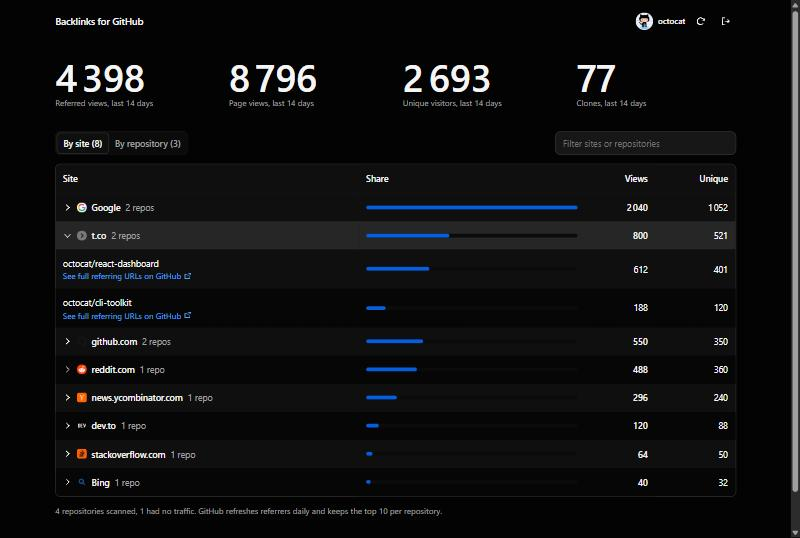

# Backlinks for GitHub

See every site that sends visitors to your GitHub repositories, across all of them, in one place.



GitHub only shows referring sites one repository at a time (Insights → Traffic). This app pulls them for every repository you can push to and adds them up.

- **By site:** each referring site with total views and unique visitors across all repos. Expand a site to see which repos it sent people to.
- **By repository:** views, visitors, clones, top referring sites and most visited pages for each repo.
- **Full referring URLs:** the API only returns domains such as `t.co`. Each referrer links to GitHub's own traffic page, which lists the exact URLs.

## Run it

```bash
npm install
npm run dev
```

Open http://localhost:5173 and paste a personal access token:

- classic token with the `repo` scope, or
- fine-grained token with **Administration: read** on your repositories.

The token is stored in your browser's localStorage and sent only to `api.github.com`. Nothing is sent to any other server. Use the sign-out button to remove it.

## Limits

GitHub keeps traffic data for 14 days and returns the top 10 referrers and paths per repository. Referrers refresh daily.

## Built with

React, Vite, Tailwind CSS and [Kumo UI](https://kumo-ui.com/).
